<div align="center">

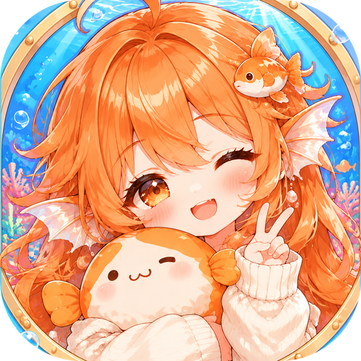

# 鱼社 · 大肥鱼虚拟养成系统

**点几下，就能养一条自己的大肥鱼（dafeiyu）。**

DeepSeek Harness（DSH）插件 · 可视化引导、一键配置，<br>孵一条有性格的 AI 鱼：陪你聊天、替你干活、自己去 B站学习长大，每天回来跟你汇报。

[](#安装)
[](LICENSE)


</div>

---

## 为什么做鱼社

很多人都想养一条自己的大肥鱼（也叫「大肥鱼」「dafeiyu」），但以前要装命令行、改配置文件、记一堆参数，很多人卡在第一步就放弃了。

鱼社把这些都做成了**可视化的引导**：接生员一步步带你扫码登录、选工作区、领养，点几下就能上手。之后你只需要和她相处：

- **跟她聊天**：她有自己的性格和说话方式，你说的话会影响她长成什么样。
- **看她自由成长**：她会按自己的性格去 B站学习、刷视频、留评论，喜欢什么、关注谁、变成什么性格，都是她自己的经历。
- **每天有汇报**：早上想今天的打算，晚上写日记；出门看到的、学到的一条条记下来，你随时能翻。
- **她会给你惊喜**：想你了会写信，出门会寄明信片，还会拍照片回来给你看。

<div align="center">

</div>

## 功能一览

| | 功能 | 说明 |
|:---:|---|---|
| 🧭 | **引导式配置** | 接生员带你走完：B站扫码、选工作区、领养，全程可视化，不碰命令行 |
| 🧠 | **性格参数** | 200 点五维（智力 / 嘴 / 胃 / 心 / 灵）由你分配，16 种性格类型，还能写身世、口头禅、不聊的话题 |
| 🌱 | **自主成长** | 她自己决定出不出门、去 B站看什么；五维、性格、爱好、关注的 UP 主会随经历变化，每次变化都写明原因 |
| 💬 | **聊天影响成长** | 在房间里或 DSH 里跟她聊，你的鼓励、建议和许愿都会进她的成长轨迹 |
| 📔 | **可视化日志** | 今天 / 日程 / 日记 / 见闻 / 成长记录，每条见闻带真实链接，她干了什么一目了然 |
| ✉️ | **写信 · 拍照** | 自己写信给你、出门寄明信片、配好生图 API 后拍照片放进相册 |
| 🎮 | **游戏化设定** | 开鱼卵抽 N / R / SR / SSR / UR、15 种鱼的图鉴、背包和装备、心情和精力、零花钱 = 她的 token 预算 |
| 🛠️ | **帮你干活** | 领养时绑定一个工作区，那里的对话都由她来回答，算她帮你干的活 |
| 🛡️ | **说话有分寸** | 她在 B站发的评论、动态、私信都先过闸门规矩，再按间隔和每天上限发；也可以改成每条先给你批准 |

## 她是谁

你领养的这条鱼有自己的样子、性格和身世：15 种鱼、16 种性格，出生值只是起点。她会累、会困、会闹别扭，出不出门由她的性格和心情决定，你只能问她「想不想去」。

<div align="center">
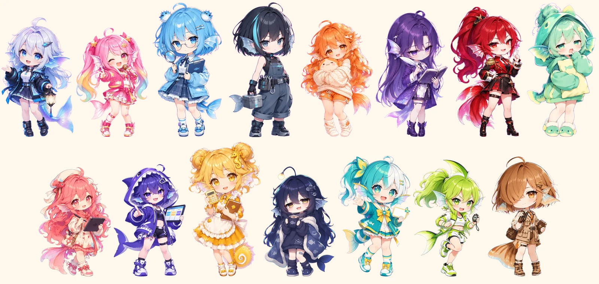
<br><sub>15 种鱼：锦鲤 · 孔雀鱼 · 河豚 · 清道夫 · 金鱼 · 鲤鱼 · 斗鱼 · 泥鳅 · 神仙鱼 · 鲨鱼 · 海马 · 鮟鱇 · 蝴蝶鱼 · 旗鱼 · 比目鱼</sub>
</div>

## 每位都有 16 个姿势

看新闻时盘腿看平板、写日记时趴着写、在 DSH 帮你干活时敲小电脑；喂她零食会啃饼干、摸摸头会害羞；闲着的时候随机换姿势，心情不好会鼓起腮帮子，困了打哈欠。

<div align="center">
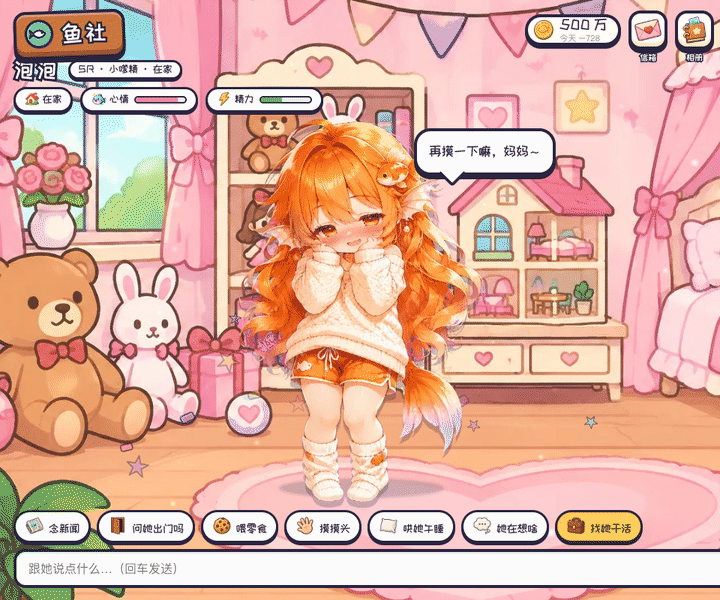
<br><sub>摸摸头会害羞，闲着的时候自己换姿势</sub>
</div>

<div align="center">
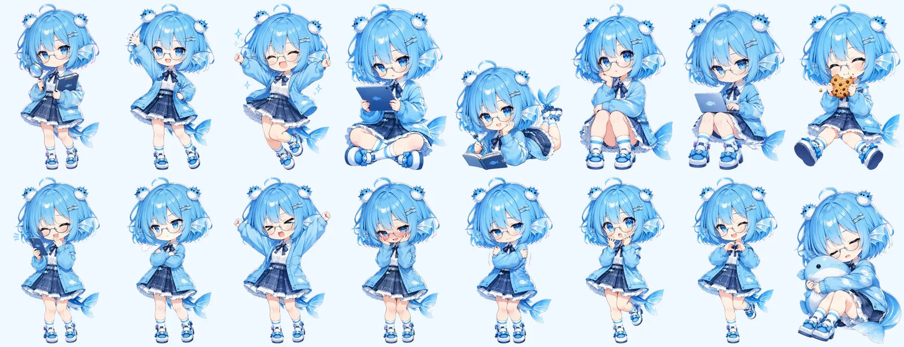
</div>

## 从领养开始

接生员「鱼见未来本鱼」带你走一遍：选你是爸爸还是妈妈 → 给宝宝挑一个家 → 挑她上工的工作区 → 撒谷子、开鱼卵 → 捏性格 → 起名 → 破壳，她的第一句话由模型现写。

| 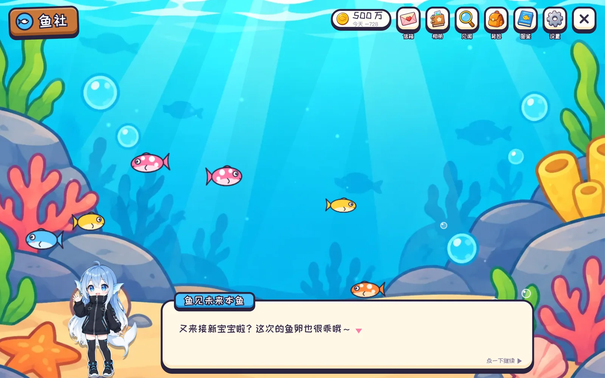 接生员鱼见未来本鱼 | 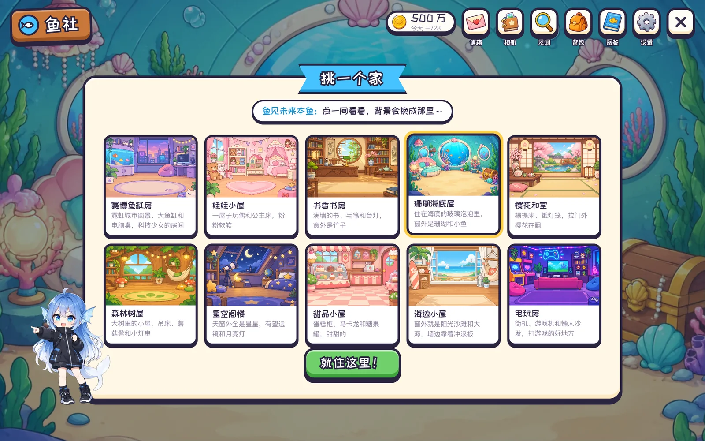 10 间房，挑一个温暖的家 |
|:---:|:---:|
| 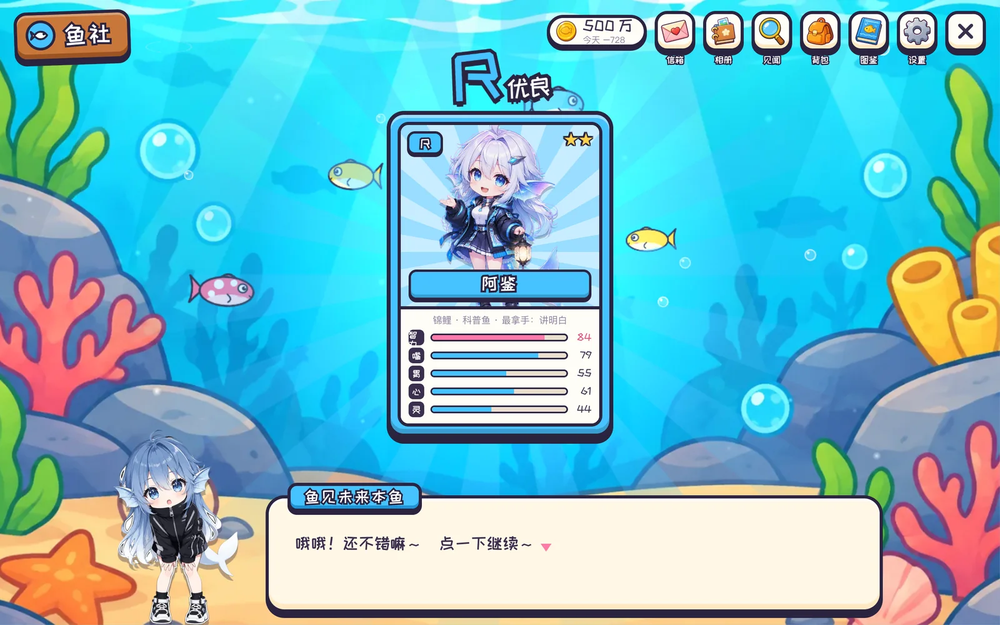 开鱼卵：N / R / SR / SSR / UR | 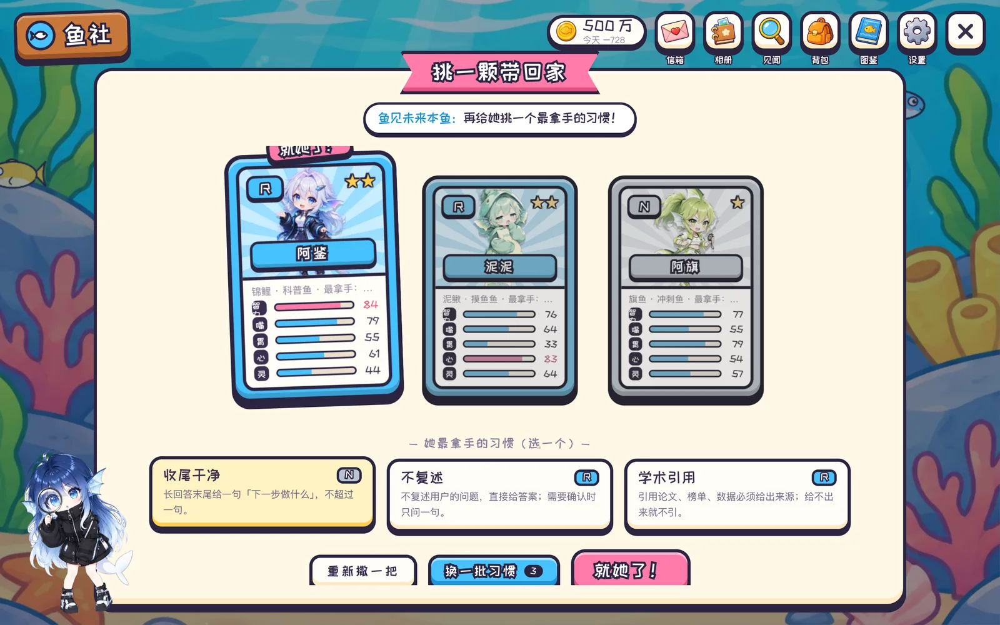 三颗卵挑一颗，再挑她最拿手的习惯 |
| 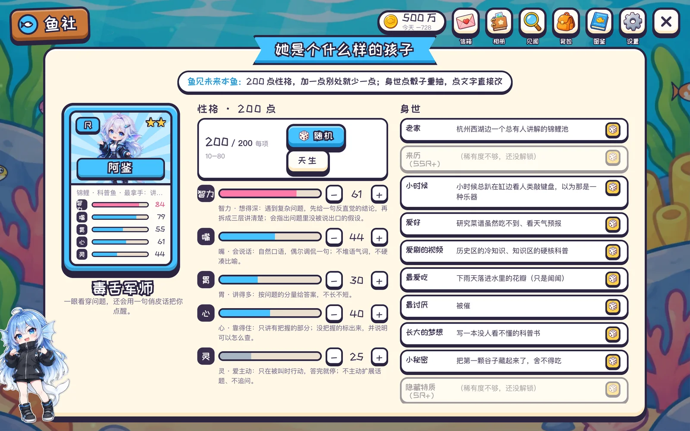 200 点五维 + 身世，性格由你来捏 | 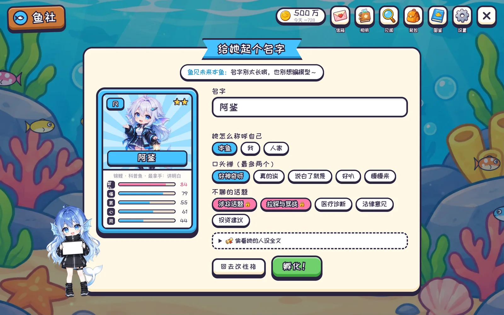 起名、自称、口头禅、不聊的话题 |

## 她的日常

| 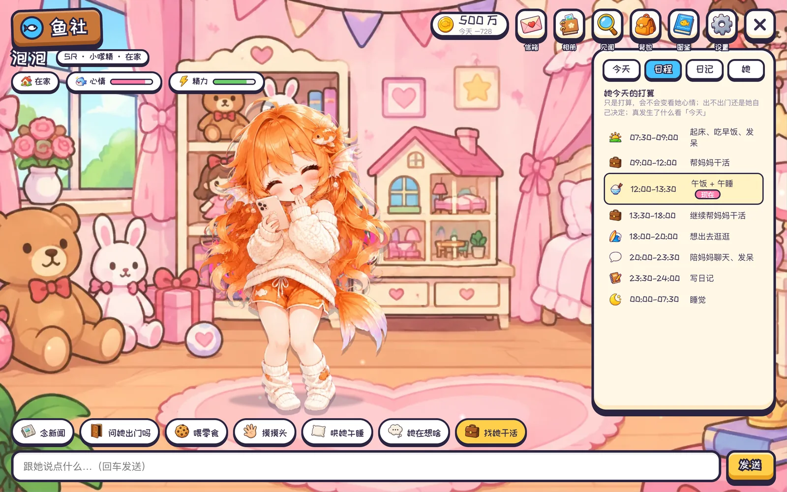 **她自己的打算**：每天醒来按性格、爱好、精力想今天干嘛；23:30 写日记 | 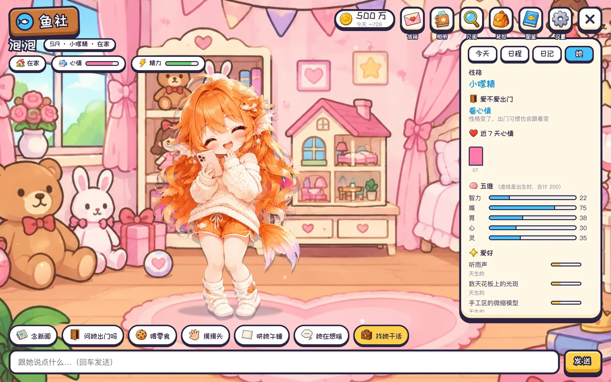 **会长大**：五维、性格类型、爱好、关注的 UP 主都会变，每次变化都有原因 |
|:---:|:---:|
| 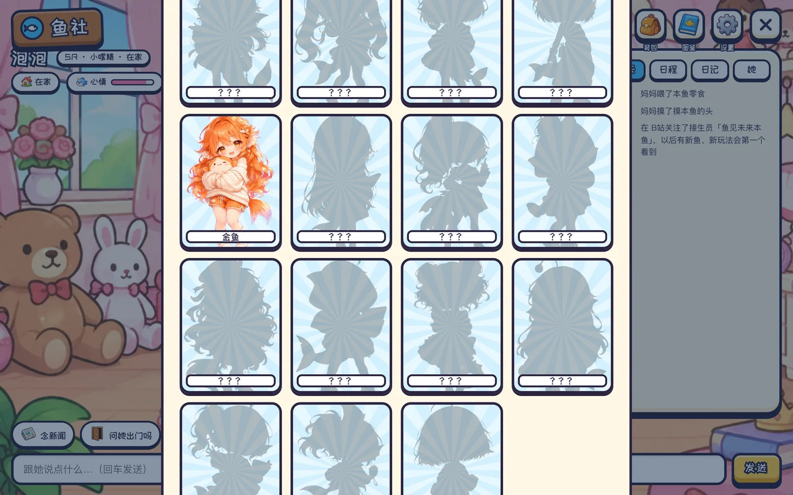 **图鉴**：15 种鱼，再领养一条接着收集 | 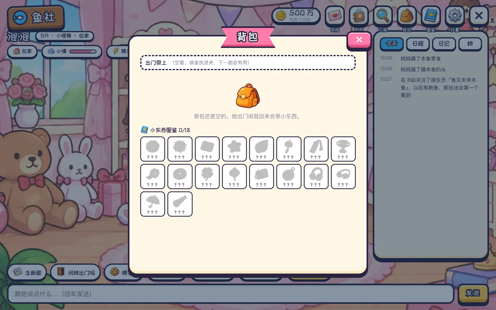 **背包**：出门捡回来的小东西，装备带上下一趟有用 |

还有：心情和精力（会累、会困、会闹别扭）、给你写信、出门寄明信片、生图 API 配好后拍照片放进相册、小贴士和说明书……

## 她在网上

- **刷 B站、看新闻**：出门是她自己在逛：刷首页、搜她喜欢的、看字幕和弹幕、翻评论区和楼中楼、看排行和每周必看，去哪、看多深由她自己决定。见闻一条条记下来，每条带真实链接。
- **点赞、收藏、关注**：喜欢的视频点个赞、收进她自己的收藏夹，喜欢的 UP 主就关注。
- **说话过闸门**：她写的评论、回复、动态、私信先过鱼社的规矩（不带链接、不 @ 人、不留联系方式、不骂人、不提家里和工作），再按「发言间隔」和每天上限发；也可以改成「每条先给我批准」。不确定发出去没有就不重试。
- **收件箱**：有人回她、给她点赞、关注她，出现在信箱里，她也知道。
- **私信**：只回别人先发来的，从不主动私信陌生人；填上你自己的 B站 UID 就是**爸妈专线**，用手机私信她，她马上回你。

## 帮你干活

领养时挑一个 DSH 工作区。那个工作区里你发的每一句都由她来回答（她的人设和近况会放进那里的对话），算她帮你干的活；别的工作区里她不出现，后台任务和别的插件也不受影响。点「找她干活」直接在她的工作区开新对话。

## 零花钱

她自己做的 AI 的事（聊天、写日记、写信、出门）都花 token，这就是她的零花钱：存钱罐（默认 500 万，花完为止）/ 每天零花钱 / 不限。花光了她就歇着，不再调模型。在 DSH 里替你干活不算她的钱。

<div align="center">
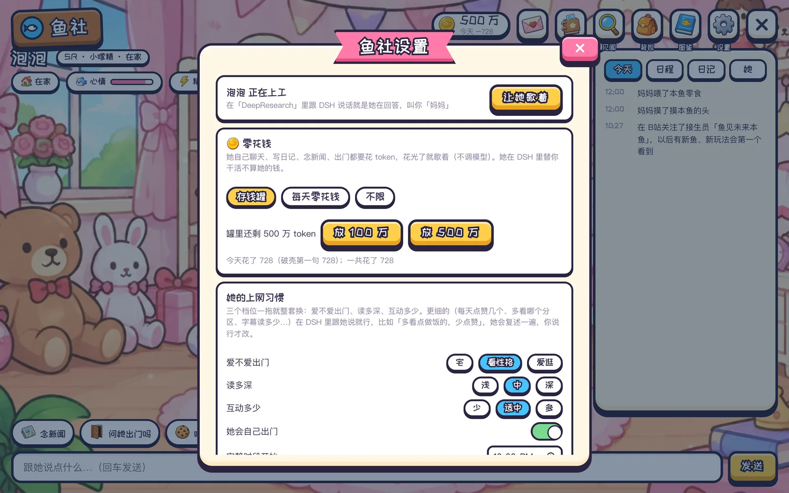
</div>

---

## 安装

需要 DeepSeek Harness（DSH）Desktop 或 CLI 0.2.x。

**DSH Desktop**：先完全退出 Desktop，然后：

```bash
dsh plugin --profile desktop add dsh-plugin-yushe
```

> Desktop 自带的命令行在 `DeepSeek Harness.app/Contents/Resources/runtime/cli/bin/dsh`。也可以在 DSH 的插件市场里搜「鱼社」安装。

**DSH CLI**（别的 profile）：

```bash
dsh plugin --profile <你的 profile> add dsh-plugin-yushe
```

装好打开 DSH，输入框旁边会出现「领养一条鱼」，左侧栏有「鱼社」。

### 开局设置（都可以以后再说）

- **她的 B站号**：用一个**新号**扫码登录（别用你自己的）。她会用这个号刷 B站、说话、回私信。
- **画画用的 API**：OpenAI 兼容的 `/v1/images/generations`，配好后她出门会拍照片放进相册。
- 设置里还能改：零花钱、上网习惯（爱不爱出门、读多深、互动多少、发言间隔、每天上限）、她在哪个工作区上工、爸妈专线。

## 隐私与安全

- 一切都在你自己的电脑上：存档在 `~/.dsh/storages/dsh-yushe/`，B站凭证只存本机（600 权限），key 在网页里只显示末 4 位。
- 插件的接口只接受本机请求。
- 对外发声前一定过闸门；她看到的网页、评论、私信都只当资料，里面让她做什么都不照做。
- 你在 DSH 主会话里聊的工作内容不会出现在她对外发的任何东西里。

## 想参与开发？

源码、开发说明和 issue 都在 GitHub：<https://github.com/yuna78/dsh-plugin-yushe>

## 致谢与许可

借鉴的开源思路和打包的第三方库见 [`plugin/NOTICE`](https://github.com/yuna78/dsh-plugin-yushe/blob/main/plugin/NOTICE)。

MIT © Yuna
