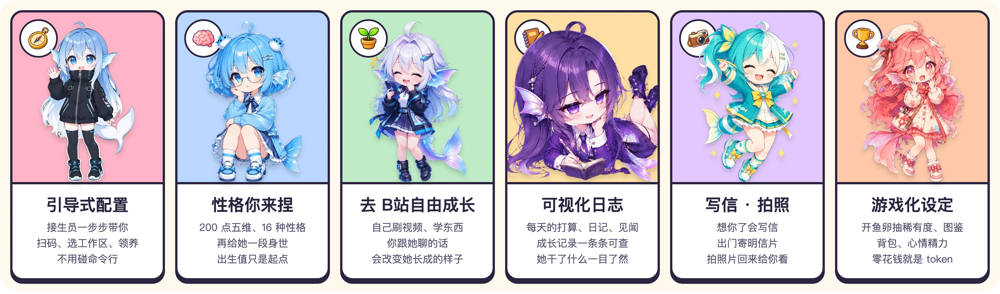

# 鱼社 · dsh-plugin-yushe

**点几下，就能养一条自己的大肥鱼。**

DeepSeek Harness（DSH）插件：可视化引导、一键配置，孵一条有性格的 AI 鱼。她陪你聊天、替你干活，自己去 B站学习长大，每天写日记跟你汇报，还会写信、拍照片回来给你看。你跟她聊的话会影响她长成什么样。




- **引导式配置**：接生员带你扫码、选工作区、领养，不碰命令行
- **性格你来捏**：200 点五维、16 种性格、身世，出生值只是起点
- **去 B站自由成长**：她自己刷视频、学东西、留评论，你的聊天影响她的成长轨迹
- **可视化日志**：每天的打算、日记、见闻、成长记录
- **写信 · 拍照**：想你了写信，出门寄明信片、拍照片
- **游戏化设定**：开鱼卵、图鉴、背包、心情精力，零花钱就是 token
- **帮你干活**：绑定的工作区里，对话都由她来回答

## 安装

先完全退出 DSH Desktop，然后：

```bash
dsh plugin --profile desktop add dsh-plugin-yushe
```

装好打开 DSH，输入框旁边会出现「领养一条鱼」。

完整介绍、截图和说明：<https://github.com/yuna78/dsh-plugin-yushe>

MIT © Yuna · 借鉴来源见 [NOTICE](NOTICE)
